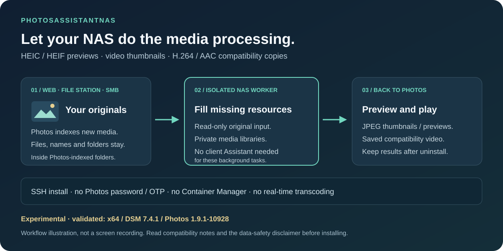

# PhotosAssistantNAS

[English](README.md) | [简体中文](README.zh-CN.md)

**Bring HEIC/HEVC processing back to your Synology NAS.**

PhotosAssistantNAS restores server-side media processing for Synology Photos: generate HEIC/HEIF photo previews, video thumbnails, and H.264/AAC compatibility copies on the NAS, taking over these tasks from client-side Image Assistant. Deploy over SSH without a Photos account, password, OTP, or Container Manager.

**Especially useful after uploads through the Photos web portal, File Station or SMB:** let the NAS generate missing resources without installing desktop Image Assistant and its browser extension, or keeping a client running to process the library.

With the changes introduced around DSM 7.2.2, Synology moved some media processing to end devices, so HEIC/HEVC previews and compatibility copies may require client assistance. This project brings that background work back to the NAS: keep your originals in place and keep using Synology Photos. See [Synology's announcement](https://www.synology.com/en-us/products/status/eol-video-codec-support) and the [Image Assistant FAQ](https://kb.synology.com/en-global/DSM/tutorial/Frequently_asked_questions_about_Synology_Image_Assistant).

The scope is preview and compatibility-copy generation. It does not restore every feature of older DSM versions or provide real-time playback transcoding.

**Experimental; source-only distribution.** Validated on x86_64, DSM 7.4.1-90080 Update 1, and Synology Photos **1.9.1-10928**. The worker uses undocumented local Photos interfaces and refuses to process media after an unvalidated Photos version change. Support for all DSM 7 releases or future versions is not implied. This project is independent of Synology.

> **Risk of data corruption or loss:** preserving originals by design is not a data-safety guarantee. Bugs, interface changes, permission errors, power loss, and storage failures can affect media and album availability. Keep an independent backup, verify recovery, and test noncritical media first. Read the [data-safety disclaimer](DISCLAIMER.md).

**Current primary version: 0.6.1 on `main`.** This is the deployed and NAS-validated baseline within the compatibility limits below, not a declaration of universal or production-grade support. The one-command installer follows `main`; no GitHub Release or public runtime binary is required. See [scope and processing decisions](docs/scope.md), [validation](docs/compatibility.md), and the [changelog](CHANGELOG.md).

## Who this is for

| Your workflow | When this project helps |
| --- | --- |
| Upload through the Photos web portal | You want the NAS to prepare previews and compatibility videos without desktop Image Assistant and its extension |
| Copy media through File Station, SMB, or another transfer method | Files enter a Photos-indexed folder, and you want missing resources generated automatically in the background |
| Mainly back up through the Photos mobile app | Usually unnecessary if your existing previews and playback already work |
| Store media elsewhere on the NAS | Out of scope until that media is indexed by Photos; this is not a NAS-wide codec replacement |

The mobile app already offers an Image Assistant switch under **More → Settings**. When enabled, it can generate JPEG previews for items being browsed, including HEIC/HEVC imported through the web portal, File Station or SMB. **It does not generate compressed compatibility videos**; mobile playback still depends on the device's decoding capability. See [Synology's explanation of desktop and mobile behavior](https://kb.synology.com/en-eu/DSM/tutorial/Unable_to_view_HEIC_photos_HEVC_videos_on_Synology_Photos).

This worker moves supported background generation to the NAS instead of relying on a phone to browse items or a desktop client to process them. It is optional when Synology's existing mobile workflow already meets your needs. Supported missing/broken states and the validated Photos version still determine whether an item is processed.

## How it works



Workflow illustration, not a screen recording. See the [NAS validation and repeatable walkthrough](docs/demo.md), or use the [community introduction draft](docs/community-post.md) to share the project with its tested scope and limitations.

## Behavior and boundaries

- No Photos account, password, OTP, or session token; no new DSM login account.
- Original files, names, and directories stay in place. Results are submitted through Photos interfaces, without a separate photo library.
- Only known missing/broken thumbnail states and missing high compatibility copies are processed. Existing usable results are skipped.
- Outputs are JPEG previews and H.264/AAC MP4 within a 720p bounding box. Encoding, bitrate, frame rate, and HDR mapping are not guaranteed to match official Assistant outputs. This is not real-time transcoding.
- A root coordinator uses DSM's local interface. Decoders run under an unregistered numeric UID with a separate network namespace, no privilege escalation, and resource limits. See [security boundaries](SECURITY.md).
- Uninstall removes this service, systemd registration, application, state, and temporary files. **Previews and compatibility copies already accepted by Photos are retained.** System audit logs and downloads kept by the user are not erased.

## Private dependencies

As checked on 2026-10-21, these are the latest applicable DSM x64 builds available from SynoCommunity. URLs and SHA256 digests are pinned in `vendor/lock.json`.

| Dependency | Version | Purpose |
| --- | --- | --- |
| FFmpeg / FFprobe | 8.1.3-5 | Read-only descriptor video input, thumbnails, H.264/AAC compatibility output |
| ImageMagick | 7.1.2-16 | HEIC/HEIF processing and JPEG thumbnails |
| SynoCli Video Drivers | 1.5-9 | Required private shared libraries and their dependency closure |

Only required files are extracted; upstream package installation scripts are never run. This project does not upgrade DSM's Python, systemd, glibc, or local interfaces. Libraries within an upstream build are not individually swapped, to preserve ABI compatibility. Dependency updates use new validated source commits rather than silently tracking the latest version.

## One-command SSH installation

GitHub hosts source and bootstrap scripts. It is not an SSH relay and does not receive NAS or Photos credentials. GitHub Releases are not used.

Run in **your NAS's own SSH terminal**:

```sh
curl -fsSL https://raw.githubusercontent.com/Gitawake/PhotosAssistantNAS/main/bootstrap.sh -o "$HOME/photos-assistant-install.sh" && sudo sh "$HOME/photos-assistant-install.sh"
```

The bootstrap displays the data-risk warning, checks the NAS, resolves `main` to a fixed commit, downloads that source, verifies pinned upstream dependencies, builds locally on the NAS, and installs the service. Temporary dependencies, source, and build files are cleaned up afterward. No Photos credentials or OTP are needed; sudo still requires DSM administrator authorization.

If `raw.githubusercontent.com` is inaccessible, use the official GitHub API to download the same entry point, with HTTPS verification:

```sh
curl -fsSL -H 'Accept: application/vnd.github.raw+json' 'https://api.github.com/repos/Gitawake/PhotosAssistantNAS/contents/bootstrap.sh?ref=main' -o "$HOME/photos-assistant-install.sh" && sudo sh "$HOME/photos-assistant-install.sh"
```

You can review the downloaded script before running it. To pin a version, download the entry point from that full commit's raw URL and pass `--ref <40-character-commit-SHA>`. Use `--check` for environment checks without downloading or installing, or `--build-only` to download/build and clean up without installation. Use `--volume /volume2` for another volume. HTTPS access to GitHub and SynoCommunity and at least 2 GiB of temporary build space are required.

Online uninstall:

```sh
curl -fsSL https://raw.githubusercontent.com/Gitawake/PhotosAssistantNAS/main/uninstall.sh -o "$HOME/photos-assistant-uninstall.sh" && sudo sh "$HOME/photos-assistant-uninstall.sh"
```

The online entry calls the installed root-controlled uninstaller, retaining all previews and compatibility copies submitted to Photos. When GitHub is unavailable, use the local uninstall command below.

## Manual build and installation (optional)

The builder uses Python 3.8+; CI covers Python 3.9 and 3.12. There are no PyPI dependencies and building does not require root. NAS installation uses DSM's Python 3 and administrator privileges.

```sh
python3 tools/build.py
```

The builder downloads three original SPKs from pinned official SynoCommunity URLs, verifies SHA256, and extracts runtime files only. **It does not run SPK installation scripts or depend on an older local SPK.** Output: `dist/PhotosAssistantNAS-0.6.1-x64.private.tar`.

**This build is for personal use; do not upload it to public Releases.** The pinned FFmpeg enables `--enable-gpl --enable-version3 --enable-nonfree`. Public binary distribution requires a redistributable build and a component-by-component origin, license, and corresponding-source audit; attaching a few license texts is insufficient. See [distribution requirements](docs/distribution.md).

Copy the build to your NAS, extract it, and run over SSH:

```sh
sudo sh install.sh
```

Sudo authorizes installation as a DSM administrator; it is not a Photos login. The default location is `/volume1/@PhotosAssistantNAS`; `--volume /volume2` is supported. Installation starts `photos-assistant-nas.service` and enables startup at boot. It scans existing media and generates missing results, using CPU and additional storage.

## Management and uninstall

```sh
sudo systemctl status photos-assistant-nas.service
sudo systemctl stop photos-assistant-nas.service
sudo systemctl start photos-assistant-nas.service
sudo /bin/python3 -I /volume1/@PhotosAssistantNAS/uninstall.py
```

Alternatively, run `sudo sh uninstall.sh` in the extracted installer directory. Add `--volume /volume2` when uninstalling from another volume.

Videos have no fixed input-size cap and a maximum duration of six hours. Root opens the original read-only and passes one descriptor to the isolated decoder. Private FFmpeg streams through the seekable `fd:` protocol: **no full source-video copy or clone, no original permission changes, and no Btrfs requirement**. HEIC/HEIF images also use the inherited read-only descriptor: a private Python/ctypes bridge connects libheif's seekable reader to ImageMagick's in-memory MagickWand API. No original-image copy, intermediate PNG/JPEG or pixel-cache file is created. Only final thumbnails and their publication staging are written. The image path limits dimensions to 64 Mi pixels and each side to 32768 pixels, ICC profiles to 4 MiB, and the ImageMagick pixel cache to 768 MiB; this is a ceiling, not a reservation or total-process memory cap. Disk/mapped caches are disabled for images; allocation failures abort the job for later retry. Decoding still uses RAM and reads the source, and the OS may swap memory to disk. Space is reserved from duration and target bitrate for decoder output, publication staging, the final Photos copy, and scratch. Free space is checked every five seconds during decoding; processing stops below 4 GiB. This is not a storage quota; other processes can still fill the disk. Each generated file is limited to 16 GiB. Thread/priority limits and a one-hour retry delay remain in place. Compatibility copies consume additional storage; do not delete an entire `@eaDir` directory to remove them.

## Tests, compatibility, and contributions

```sh
python3 -m unittest discover -s tests -v
python3 tools/check_public.py
python3 tools/package_source.py
```

- [Compatibility and hardware validation](docs/compatibility.md): tested behavior and unvalidated cases.
- [Architecture and privileges](docs/architecture.md): root coordination and decoder isolation.
- [Contributing](CONTRIBUTING.md): use synthetic media; do not submit NAS addresses, credentials, or private media.
- [Third-party components](THIRD_PARTY.md): project source is MIT; third-party runtimes do not automatically become MIT.

Source archives contain public files only, without private runtimes, prototype installers, or raw debugging records. Read the full [disclaimer](DISCLAIMER.md).

## Inspiration and acknowledgements

The initial inspiration was [octavianx/synology-photos-server-side-thumbnailgen](https://github.com/octavianx/synology-photos-server-side-thumbnailgen): moving photo-library processing back to the NAS. Thank you to original author octavianx and the contributors to FFmpeg, ImageMagick, SynoCommunity, and their dependencies. The original MIT copyright notice is retained. See [acknowledgements](ACKNOWLEDGEMENTS.md) for attribution and dependency references, and [THIRD_PARTY.md](THIRD_PARTY.md) for usage and licensing boundaries.

[Hardware acceleration and backend status](docs/hardware.md).

[Event-driven processing and recovery](docs/events.md).
